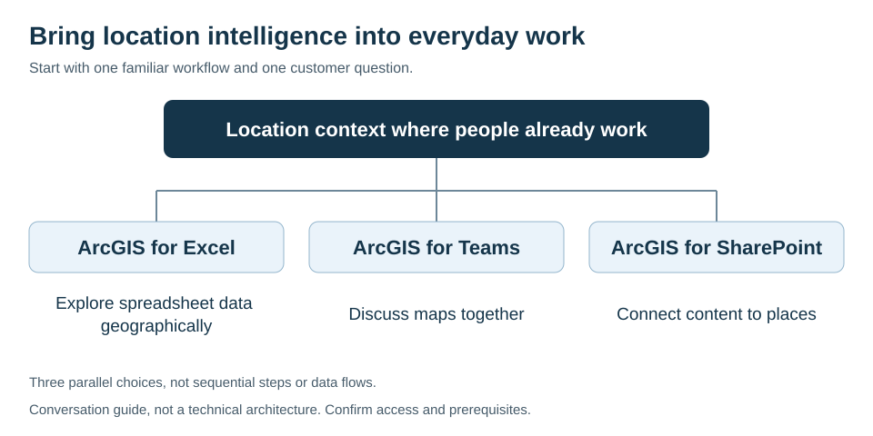

## Bring location intelligence into everyday work

Your customer has addresses in spreadsheets, maps discussed in meetings, and
documents tied to places. Start there. ArcGIS for Microsoft 365 extends location
context into familiar workflows so more people can explore the information
without beginning with a separate GIS training conversation.

The customer value is a shared understanding of places, assets, and service
areas where employees already work. It is not a promise that every employee
gets every ArcGIS capability.

## Choose a familiar workflow

Conversation guide, not a technical architecture. These are parallel choices,
not sequential steps or data flows. The table below provides the page links.
[Open or edit the draw.io diagram](../../assets/diagrams/microsoft-365-workflows.drawio.svg).

| Customer works in   | ArcGIS experience                      | What becomes possible                             |
| ------------------- | -------------------------------------- | ------------------------------------------------- |
| Excel               | [ArcGIS for Excel](excel.md)           | Explore spreadsheet data geographically           |
| Teams               | [ArcGIS for Teams](teams.md)           | Bring maps and spatial content into collaboration |
| SharePoint          | [ArcGIS for SharePoint](sharepoint.md) | Add location context to organizational content    |

These are documented product capabilities. Business outcomes depend on the
customer's data, workflow, access, and evaluation.

## Why a customer cares

* Explore where spreadsheet records cluster or leave gaps
* Discuss an interactive map instead of only a static picture
* Connect lists and documents to the places they describe
* Make geographic context accessible to colleagues beyond GIS specialists

## Start with one question

> Where do your employees already use information about places, and what decision
> would become clearer if they could see that information geographically?

| Listen for                                 | Ask next                                                        | A useful first look                       |
| ------------------------------------------ | --------------------------------------------------------------- | ----------------------------------------- |
| "We have location data in Excel."          | "Which rows represent places, and what do you need to compare?" | [Excel starting page](excel.md)           |
| "Our users already live in Teams."         | "Which map would help the next team discussion?"                | [Teams starting page](teams.md)           |
| "Documents and lists relate to our sites." | "How do people find information about a particular place?"      | [SharePoint starting page](sharepoint.md) |

## See it

Use Esri's [Try ArcGIS for Microsoft learning path](https://learn.arcgis.com/en/paths/try-arcgis-for-microsoft/).
Choose a relevant exercise before a meeting and confirm its prerequisites.
For a quick visual introduction, link to the original
[Microsoft 365 product page](https://www.esri.com/en-us/arcgis/products/arcgis-for-microsoft/arcgis-for-microsoft-365);
do not copy its images into a deck or this repository without reuse approval.

## Check before promising

Involve the customer's Microsoft 365 administrator and GIS owner. Confirm the
supported client, app installation policy, ArcGIS account and user type,
content permissions, and any service or credit requirements in current docs.
Guest and signed-in capabilities differ by product.

Government-cloud availability, customer-specific compliance, and the proposed
end-to-end workflow: **Needs current-source validation**. A public product page
does not establish suitability for a particular tenant.

## Learn more

Authoritative sources reviewed 2026-10-27:

* [Esri: ArcGIS for Microsoft 365](https://www.esri.com/en-us/arcgis/products/arcgis-for-microsoft/arcgis-for-microsoft-365)
* [Esri: Get started with ArcGIS for Excel](https://doc.arcgis.com/en/excel/latest/get-started/get-started-with-arcgis-for-excel.htm)
* [Esri: Introduction to ArcGIS for Teams](https://doc.arcgis.com/en/teams/latest/get-started/introduction-to-arcgis-for-teams.htm)
* [Esri: Introduction to ArcGIS for SharePoint](https://doc.esri.com/en/arcgis-sharepoint/latest/get-started/get-started-with-arcgis-for-sharepoint.html)

The review date records a source check, not a publication date or a tested deployment.
The SharePoint documentation destination was rechecked on 2026-10-30.

For a workflow example and recent SharePoint release reading, use
[Relevant blogs](../../07-resources/relevant-blogs.md#start-with-a-customer-conversation).

## Go deeper

Prepare with the [Seller Quick Start](../../01-start-here/seller-quick-start.md),
then hand unresolved requirements to the
[architecture review](../../05-architecture/README.md).
Browse the [full catalog](../README.md) or return to the [seller front door](../../README.md).
